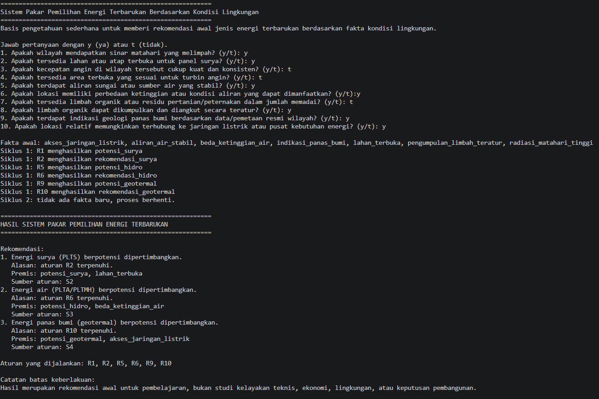
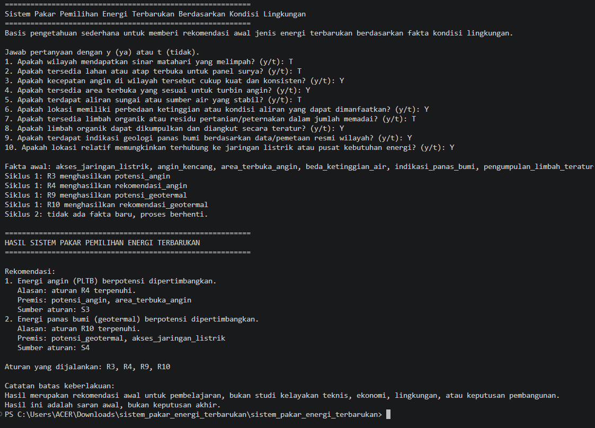
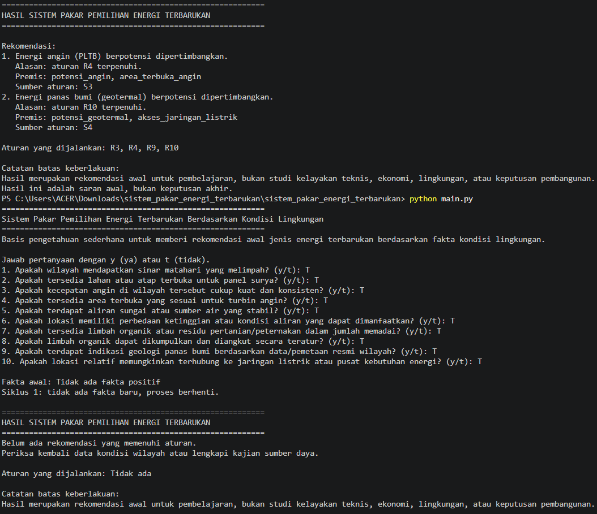

<div align="center">

# 🌿 Sistem Pakar Pemilihan Energi Terbarukan
### Berdasarkan Kondisi Lingkungan Menggunakan Metode *Forward Chaining*

[](https://www.python.org/)
[]()
[]()

</div>

---

## 📌 1. Identitas Mahasiswa
| Atribut | Keterangan |
| :--- | :--- |
| **Nama Lengkap** | Anak Agung Ayu Intan Putri Maharani |
| **NIM** | F1D02510037 |
| **Mata Kuliah / Tugas** | Sistem Pakar (Pencarian *Forward Chaining*) |

---

## 🚀 2. Topik & Cara Menjalankan Program
- **Topik:** Sistem Pakar Penentuan Potensi Energi Terbarukan (Di luar bidang kesehatan).
- **Bahasa & Versi:** Python (versi terbaru)
- **Cara Menjalankan Program:**
  1. Pastikan file basis pengetahuan (`kb_energi.json` atau file aturan) dan program utama (`main.py`) berada dalam satu folder yang sama.
  2. Buka terminal pada direktori tersebut.
  3. Jalankan perintah berikut:
     ```bash
     python main.py
     ```

---

## 📚 3. Daftar Sumber dan Tabel Aturan
- **Sumber Basis Pengetahuan:** Diambil dari literatur resmi, jurnal pendukung, dan dokumentasi teknis energi terbarukan.

- **Tabel Aturan (IF-THEN):** Menggunakan minimal 5 aturan dengan mode logika *DAN* (*AND*) serta melibatkan rantai aturan (*Forward Chaining*) secara bertingkat.

| Aturan | IF (Premis / Kondisi) | THEN (Konklusi / Hasil) | Sumber |
| :--- | :--- | :--- | :--- |
| **R1** | radiasi_matahari_tinggi | potensi_surya | S1 |
| **R2** | potensi_surya AND lahan_terbuka | rekomendasi_surya | S2 |
| **R3** | angin_kencang | potensi_angin | S1 |
| **R4** | potensi_angin AND area_terbuka_angin | rekomendasi_angin | S3 |
| **R5** | aliran_air_stabil | potensi_hidro | S1 |
| **R6** | potensi_hidro AND kondisi_aliran_sesuai | rekomendasi_hidro | S3 |
| **R7** | limbah_organik_memadai | potensi_biomassa | S1 |
| **R8** | potensi_biomassa AND pengumpulan_limbah_teratur | rekomendasi_biomassa | S4 |
| **R9** | indikasi_panas_bumi | potensi_geotermal | S1 |
| **R10** | potensi_geotermal AND akses_jaringan_listrik | rekomendasi_geotermal | S4 |

---

## 🧠 4. Metode yang Dipilih
> **Forward Chaining (Pelacakan Maju):** 
> Proses penalaran dimulai dari fakta-fakta lingkungan awal yang diinput oleh pengguna, kemudian dicocokkan dengan basis pengetahuan aturan secara bertahap (per siklus) hingga menurunkan konklusi atau rekomendasi akhir yang valid.

---

## 🧪 5. Tiga Kasus Uji dan Screenshot
Berikut adalah hasil pengujian program menggunakan 3 skenario kasus uji yang berbeda:

### 🌟 Kasus 1: Pengujian Kondisi Positif (Multi-Rekomendasi)
- **Deskripsi:** Mengaktifkan sejumlah fakta lingkungan terkait surya, hidro, dan geotermal secara bersamaan.
- **Hasil Eksekusi Terminal:**


---

### 💨 Kasus 2: Pengujian Kondisi Positif Alternatif (Angin & Geotermal)
- **Deskripsi:** Menguji jalur aturan pada potensi energi angin dan panas bumi.
- **Hasil Eksekusi Terminal:**


---

### ❌ Kasus 3: Kasus Negatif (Tanpa Kesimpulan)
- **Deskripsi:** Menguji skenario di mana seluruh fakta bernilai "tidak" (tidak ada premis yang memenuhi syarat aturan).
- **Hasil Eksekusi Terminal:**


---

## ⚠️ 6. Batas Keberlakuan
Sistem pakar ini menggunakan basis pengetahuan terbatas dari literatur teknis untuk memberikan rekomendasi awal potensi wilayah. Hasil yang dikeluarkan oleh program ini bersifat saran atau pertimbangan awal bagi pembelajaran, bukan merupakan keputusan mutlak penentuan kelayakan pembangunan fisik pembangkit listrik.

---
## 🎯 7. Kesimpulan Disertai Alasan
Berdasarkan hasil eksekusi program sistem pakar, kesimpulan yang diberikan kepada pengguna selalu disertai dengan alasan penelusuran aturan (*traceability*), yang meliputi:
1. **Nama Rekomendasi:** Jenis energi terbarukan yang dinilai potensial untuk dikembangkan di wilayah tersebut.
2. **Aturan yang Terpicu:** Identifikasi nomor aturan (contoh: `R2`, `R4`, `R6`) yang berhasil terpenuhi selama proses pelacakan maju (*Forward Chaining*).
3. **Premis Pendukung:** Fakta-fakta lingkungan apa saja yang mendasari munculnya rekomendasi tersebut (misalnya kombinasi radiasi matahari tinggi dan ketersediaan lahan terbuka).
4. **Sumber Literatur:** Referensi asli (`S1`, `S2`, `S3`, `S4`) dari mana aturan tersebut diturunkan.

## 🤖 8. Penggunaan Alat Bantu AI
- Digunakan secara kolaboratif untuk membantu perancangan struktur basis pengetahuan, penyusunan logika program inferensi *Forward Chaining* dengan Python.

---
## 📖 9. Daftar Pustaka & Sumber Referensi
1. **Kementerian Energi dan Sumber Daya Mineral (ESDM) Republik Indonesia.** (*Dokumentasi dan Pedoman Potensi Energi Baru Terbarukan di Indonesia*). Diakses dari situs resmi [Kementerian ESDM](https://www.esdm.go.id/assets/media/content/content-outlook-energi-indonesia-2019-bahasa-indonesia.pdf). *(Digunakan sebagai acuan S1 dan S4)*.
2. **Jurnal Ilmiah / Artikel Universitas (TEKIBA).** (*Kajian Teknis Pemanfaatan Potensi Energi Terbarukan Skala Regional*). Diakses dari portal jurnal ilmiah [E-Journal UNIBABWI](https://ejournal.unibabwi.ac.id/index.php/tekiba/article/download/4646/2938/27669). *(Digunakan sebagai acuan S2 dan S3)*.
